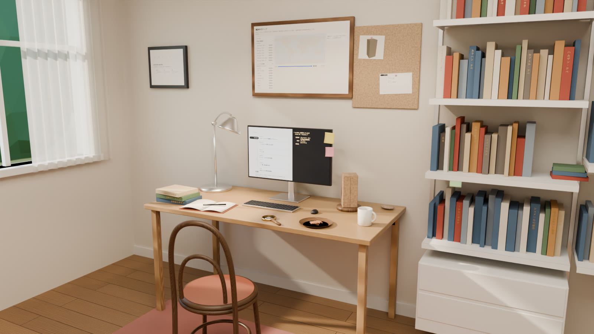

# aw-study

古代史研究者の書斎を Blender で組む練習。シーンはすべて Python（`bpy`）のコードで生成し、
外部の API キー・素材のダウンロードなしで再現できる。



動画（6秒、カメラのドリー＋手ブレ、画面のスクロール、付箋のなびき）: [`docs/screenshots/aw-study/study.mp4`](../../docs/screenshots/aw-study/study.mp4)

## 何が入っているか

| 要素 | 中身 | どこ |
|---|---|---|
| 部屋 | 4.2m×3.6m、天井高2.7m。左の壁に窓、レースのカーテン、外に地面と木立 | `scene/room.py` |
| 光 | 午後の西日（太陽＋空）、窓のポータル、天井の補助光、デスクライトとペンダントの電球色 | `scene/room.py` `scene/furniture.py` |
| 名作家具・照明（似せたもの） | 606 風シェルフ、Tolomeo 風デスクライト、PH5 風ペンダント、Thonet No.14 風の椅子 | `scene/furniture.py` |
| 遺物 | **Weld-Blundell Prism の模型**（aw-objects と同じ寸法・同じ扱い）、粘土板、土器片 | `scene/props.py` |
| リポジトリの中身 | 壁に aw-map と aw-lp、コルクボードに aw-objects と aw-timeline の切り抜き、モニターに年表、本の背に台帳（aw-data）のクラスタ名・遺跡名 | `scene/build.py` `scene/props.py` |
| 動き | カメラのドリー＋手ブレ（F カーブのノイズ）、年表のスクロール、推論ログのタイプ表示、付箋3枚のなびき | `scene/motion.py` |

素材はすべてプロシージャル（木目・漆喰・粘土・布）。画像を使うのは画面とポスターだけで、
どれもリポジトリ内の `docs/screenshots/` のスクリーンショット。

## 動かし方

Blender の Python モジュール `bpy` で動く。`bpy` 5.2 は Python 3.13 が必要。

```bash
python3.13 -m venv .venv && .venv/bin/pip install -r packages/aw-study/requirements.txt

cd packages/aw-study
../../.venv/bin/python scene/build.py --mode preview            # 960x540、確認用（数十秒）
../../.venv/bin/python scene/build.py --mode still --frame 72   # 1600x900、仕上げ（4コアの CPU で約7分）
../../.venv/bin/python scene/build.py --mode anim               # 640x360 × 144 フレーム → out/study.mp4（約20分、ffmpeg が要る）
../../.venv/bin/python scene/build.py --mode preview --blend out/study.blend   # .blend も保存
```

GUI の Blender からは `blender -b -P scene/build.py -- --mode preview` でも同じものが組める。
出力は `out/`（Git 対象外）。

**描画は Cycles の CPU。** EEVEE は GPU（EGL）の無い環境では起動できないため使っていない。
推論ログのタイプ表示は frame_change ハンドラで動かしていて、ハンドラは .blend に保存されない。
保存した .blend を GUI で再生するとログは止まって見える（カメラ・付箋・スクロールはキーなので動く）。

## 作り方の流れ

投稿で見かけた「AI で書斎を作る」流れを、キーなしで回せる形に置き換えた:

1. **シーンイメージ** — 画像生成の代わりに、構図（机は奥の壁、窓は左、棚は右手前）を
   コードの座標で直接決めた。座標系は `scene/room.py` の冒頭にある
2. **Tripo かモデリングかの判定** — [`plan/objects.md`](plan/objects.md)。初版は全部モデリング。
   キーが入ったら「Tripo 向き」の行だけ差し替える
3. **住環境のヒアリング** — [`plan/hearing.md`](plan/hearing.md)。答えに応じて寄せていく
4. **名作の再現モデリング** — 製品の寸法図ではなく、外形の特徴（部材の構成とプロポーション）を
   手で起こしたもの。ロゴ・商標は入れない
5. **自分のコンテンツを入れる** — このリポジトリのスクリーンショットと台帳の名前
6. **動く要素** — `scene/motion.py`

## 次にやること（改善の候補）

- 角柱の模型: 粘土の質感が強すぎてコルクに見える。凹凸を弱め、欄の溝を見えやすく
- 窓の外: 木立が平たい。HDRI を使わない範囲で、奥行きのある木立か隣家の壁を置く
- カーテンのなびき（付箋と同じく風の向きに合わせる）、光の筋に舞うほこり（ボリューム。CPU だと重い）
- 机の上の生活感: ケーブル、メモの走り書き、椅子の背に掛けた上着
- ヒアリングの答えを入れて、機材と小物を実物に寄せる
- 時間帯の切り替え（夜はデスクライトとペンダントだけ）
