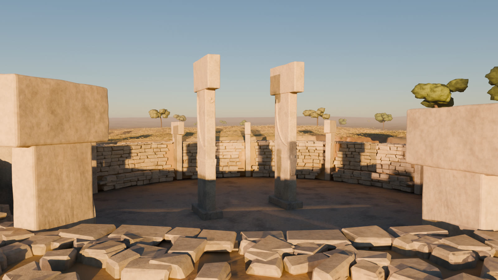

# aw-world

古代世界の場面を Blender で描く。第一の場面は **ギョベクリ・テペ（第III層、前9600年頃）の復元イメージ**。
シーンはすべて Python（`bpy`）のコードで生成し、外部の API キーや素材のダウンロードなしで再現できる。



動画（6秒）: [`docs/screenshots/aw-world/gobekli.mp4`](../../docs/screenshots/aw-world/gobekli.mp4)。
西南西の上空から夕日を背にして降り、周壁の柱の間から中央の2本を見るクレーンショット。

場面の一覧:

| 場面 | 中身 | 場所 |
|---|---|---|
| ギョベクリ・テペ（第III層） | 復元イメージの静止画と 6 秒のクレーンショット | `scene/`（この README） |
| アトランティス（伝説の都） | 『クリティアス』による想像図。DXF 図面 4 枚と、音つき 20 秒の動画 | [`atlantis/`](atlantis/README.md) |

## これは復元イメージである

**発掘記録の再現ではなく、わかっていることを骨組みにして、残りを想像で補った情景。**
年代の表記は台帳（`aw-data` の `gobekli-tepe`: `era_start = -9600`、「最古の層」）から取る。

### わかっていること（形の拠り所。値は公開資料でよく引かれる概数）

| 項目 | このシーンでの扱い |
|---|---|
| 円形の囲い遺構があり、中央に2本の大きな T 字柱、周壁に柱が埋め込まれている | 囲い D をこの構成で組む |
| 囲い D の直径はおよそ 20m、中央の柱は高さ 5.5m 前後、周壁の柱は 11〜12 本 | 内半径 8.6m・外半径 10.4m、中央柱 5.5m、周壁の柱 11 本 |
| 中央の大柱には人体表現がある（側面の腕、正面で合わさる手、帯、腰布） | 腕・指・帯・腰布を浮彫として付ける |
| 周壁の柱には動物の浮彫がある（キツネ、イノシシ、ヘビ、鳥など） | 様式化したシルエットを数本の柱に付ける |
| 周壁は割り石積みで、内側にベンチがある | 割り石を積み、内側にベンチの石を回す |
| 囲いは周りの地面より低く、床は岩盤を削って均している | 床を地表から約 2.3m 掘り下げ、岩盤の床と柱の台座を置く |
| 石灰岩の丘陵の上にあり、南の平原を見下ろす | 南へ下る地形にする（等高線の再現ではない） |

### 推測で埋めたもの

| 項目 | 埋め方 |
|---|---|
| 柱の断面寸法、頭部の張り出し | 中央柱は幅 1.15m・厚さ 0.38m、頭部 1.95m。周壁の柱は乱数で幅 0.75〜0.95m・高さ 3.2〜3.9m |
| 浮彫の位置と形 | どの柱に何があるかは写していない。動物は輪郭を単純化した**様式化**で、実物の図像の写しではない |
| 首飾り（三日月と円盤） | 中央柱の片方の正面に置いた。位置と大きさは仮置き |
| 周壁の高さ、石の大きさ | 壁の天端を周りの地表にそろえた。石は 0.3〜0.65m の乱数 |
| 囲い A・B・C の位置と大きさ | D の周りに寄せた**模式的な配置**。実際の平面図ではない |
| 屋根の有無 | 屋根を架けたかどうかは議論がある。このシーンでは架けていない |
| 植生（草、穂をつけた野生の麦、低い木の疎林） | 当時の環境として「ありえた」姿。種と密度に根拠はない |
| 炉、上空のハゲワシ | 演出。場所と数に根拠はない |
| 時間帯（夕方、西南西からの低い太陽） | 演出 |
| 人の姿 | 入れていない（服装や道具を推測で描くことになるため） |

## 動かし方

`bpy` 5.2 は Python 3.13 が必要。

```bash
python3.13 -m venv .venv && .venv/bin/pip install -r packages/aw-world/requirements.txt

cd packages/aw-world
../../.venv/bin/python scene/build.py --mode preview        # 960x540（4コアの CPU で約2分）
../../.venv/bin/python scene/build.py --mode still          # 1600x900
../../.venv/bin/python scene/build.py --mode anim           # 640x360 × 144 フレーム → out/gobekli.mp4（ffmpeg が要る）
../../.venv/bin/python scene/build.py --mode preview --view=-3.5,-5.5,1.7:-1.7,0.6,2.6   # カメラを固定して確認（位置:注視点）
```

出力は `out/`（Git 対象外）。描画は Cycles の CPU（EEVEE は GPU の無い環境で起動しないため）。

## 構成

| ファイル | 中身 |
|---|---|
| `scene/build.py` | 入口。囲いの配置表（`ENCLOSURES`）、太陽と空、カメラ、レンダリング設定 |
| `scene/terrain.py` | 地形。近景 0.5m 格子と遠景の2枚。囲いの掘り込み |
| `scene/enclosure.py` | T 字柱、人体表現、動物の浮彫、割り石の周壁とベンチ、岩盤の床 |
| `scene/life.py` | 草（パーティクル）、木立、炉の炎、ハゲワシ、空気遠近（距離でかすむ） |
| `scene/materials.py` | 石灰岩・土・草・葉・炎。すべてプロシージャル |
| `scene/util.py` | メッシュ生成とアニメーションの道具（`aw-study` と同じもの） |

## 次にやること

- 人体表現をもっと読めるように（腕の浮彫をはっきり、光を横から当てるカット）
- 囲い D の柱の配置を平面図に寄せる（柱番号と向き）
- 別の場面: シュメールの都市（エリドゥ）、青銅器時代の崩壊、エジプト、縄文の集落
